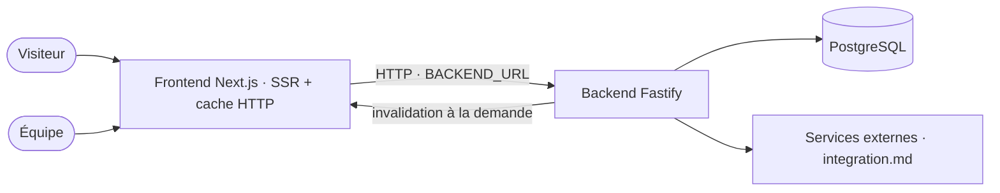

# Architecture

## Stack

- TypeScript de bout en bout, pnpm. Deux applications indépendantes sous `src/`, chacune avec son `package.json`
- Frontend : Next.js (App Router, Server Components), Tailwind, next-intl
- Backend : API REST Fastify, Prisma, PostgreSQL

## How it fits together

## Key decisions

- Le backend seul possède Prisma et la base ; le frontend passe toujours par l'API HTTP
- Pages publiques en SSR avec cache HTTP (`s-maxage=3600, stale-while-revalidate=60`, l'accueil à `s-maxage=300` — RG-003), invalidées à la demande depuis l'admin via `/api/revalidate` ; pages authentifiées en hybride SSR + SPA
- Le frontend joint le backend par `BACKEND_URL` (`http://backend:4000` en local), figé dans `routes-manifest.json` **au build** : le changer exige un redéploiement sans cache
- `fetchAPI` (`src/frontend/src/lib/api.ts`) sépare « absent » (404 → `null`) et « cassé » (`BackendUnavailableError`). Les confondre a mis en cache un 404 pendant une heure sur une ressource qui existait (#345) — détail dans `.claude/rules/error-handling.md`
- Sponsors et speakers sont des entités partagées entre éditions ; ce qu'une édition a affiché est figé sur la participation (#129, #351, #375)
- Les tâches planifiées tournent dans le processus backend (`node-cron`, `src/backend/src/lib/scheduler.ts`) : correct tant qu'il n'y a qu'un réplica. Même hypothèse pour le flux temps réel de l'accueil (#641) : Server-Sent Events diffusés en mémoire (`lib/arrivals-stream.ts`) ; un second réplica exigerait `LISTEN/NOTIFY`
- Flux SSE (`GET /api/arrivals/:editionId/stream`) : la réponse est détournée (`reply.hijack()`), donc ni compression ni en-têtes de helmet ; un ping toutes les 15 s garde la connexion sous le délai d'inactivité de 30 s du relais de Next. Chaque (re)connexion commence par l'état complet, et chaque badge porte une version que l'écran ne fait jamais reculer
- Zone `/arrivees` : seule partie du site avec un service worker (`public/arrivees-sw.js`, portée `/arrivees`, #641), enregistré en build de production seulement. Il garde l'application, jamais `/api`. Le vérifier exige un `next start` : sous `next dev` il se désinscrit
- Écran Scan (#642) : seule page qui ouvre la caméra (`Permissions-Policy: camera=(self)` sur `/arrivees` seulement, `next.config.ts`). Lecture par `BarcodeDetector` quand le navigateur l'a, sinon `zxing-wasm` (iOS, et Chrome desktop sous Windows), dont le `.wasm` est **recopié** dans `public/arrivees-zxing/` : le CDN par défaut est bloqué par la CSP et absent hors ligne. Après une mise à jour du paquet, recopier le fichier (`barcode-reader.test.ts` échoue sinon). La CSP porte `'wasm-unsafe-eval'` pour lui. Mode dégradé : table empreinte du code → numéro dans le `localStorage`, empreinte SHA-256 tronquée à 24 bits (ni nom ni code valide sur un téléphone perdu), même calcul côté backend et navigateur
- Écran Guichet (#643) : kanban trié par `Attendee.badgeStateAt` (heure d'arrivée dans l'état), posé par `moveBadge`, seul chemin qui change un état. Les bacs sont numérotés **à partir de 0** comme sur les badges (RG-ARR-15 : `2047` = guichet 2, bac 0) ; les guichets à partir de 1. Le son d'une nouvelle carte reste coupé tant que la page n'a pas été touchée (règle d'autoplay des navigateurs) : l'écran l'affiche
- Écran Aide (#713) : l'étiquette s'imprime par le pilote de la Zebra, depuis la boîte d'impression du navigateur. Elle est rendue en `createPortal` hors de l'application (`print-only`, tout `ArrivalsWorkspace` en `no-print`) avec un `@page` à la taille du rouleau ; le vérifier par un `page.pdf({ preferCSSPageSize: true })` de Playwright, qui donne la vraie taille de page. Une étiquette remise passe le badge en Distribué avec `labelDeliveredAt` : hors du kanban et des charges, comptée à part ; un nouveau `moveBadge` l'efface
- SEO : Schema.org (Event, Organization, Person, Article), Open Graph, images OG dynamiques ; les métadonnées d'une page passent par `pageMetadata()` (`src/frontend/src/lib/page-metadata.ts`)
- Objectifs non négociables : Lighthouse ≥ 90, Core Web Vitals, WCAG 2.1 AA — `docs/objectifs-techniques.md`

## Gotchas

- Les pages publiques sont rendues une fois puis servies du cache de Next (`x-nextjs-cache: HIT`), pas à chaque visite (#700). Un seul appel lié à la requête (`headers()`, `cookies()`, `searchParams`, `getLocale()` sans `setRequestLocale`) au-dessus d'une page la rend dynamique, et un layout racine qui en fait un rend **tout** dynamique : c'est pour cela qu'il y a deux layouts racines, `[locale]/layout.tsx` (langue prise de l'URL) et `(app)/layout.tsx` (français fixe). Toute page de `[locale]/` appelle `setRequestLocale(locale)` ; une page qui lit `searchParams` déclare `dynamic = "force-dynamic"`. `next build` ne dit pas pourquoi une page est dynamique (il classe même les `force-dynamic` en SSG) : `src/app/static-rendering.test.ts` épingle les causes, et seule une requête sur `next start` donne la preuve (`x-nextjs-cache: MISS` puis `HIT`). `generateStaticParams` du layout est **vide** : rien n'est prérendu au build (le backend est injoignable pendant le build Docker), chaque page se rend à sa première requête. Le cache ISR (`.next/server/route-cache`) est celui de Next, via `cache-handler.js` qui **refuse de stocker les 404** : sans lui, chaque URL inventée par un robot laissait ~150 Ko sur le disque partagé avec la prod, sans limite (349 Mo après 2 300 requêtes en local)
- Une page qui affiche une fiche à travers un lien (un speaker sur ses conférences, son sponsor, son édition) ne se purge pas avec la fiche : les écritures de speakers et de conférences passent par `lib/page-footprint.ts`, lu avant **et** après l'écriture (#633). Une conférence de l'édition en avant n'a qu'une page, `/conferences/<slug>` : l'adresse datée redirige en 307, pas en 308, car l'édition en avant change chaque année
- Aperçu des brouillons (#618) : en draft mode de Next, les pages speaker, conférence et sponsor lisent `/api/admin/preview/*` par `lib/preview.ts`, cookies transmis, sans cache. Les images OG et social cards gardent les getters publics : un brouillon ne doit jamais entrer dans une image en cache. Les règles `s-maxage` de `next.config.ts` s'effacent devant le cookie `__prerender_bypass`, sinon elles écraseraient le `no-store` de Next
- Next **remplace** le bloc `openGraph` d'un layout au lieu de le fusionner : une page qui en déclare un perd `og:site_name`, `og:locale` et `og:type`. Un test interdit `openGraph:` dans les pages (#384)
- `request.ip` vient de `X-Forwarded-For` compté en sauts depuis la socket : `TRUST_PROXY_HOPS` (`lib/server-options.ts`, #663), `1` déployé (Traefik remplace l'en-tête, le rewrite de Next le transmet sans rien ajouter, le saut de confiance est le conteneur frontend), `0` en local. Le `trustProxy` numérique de Fastify ne fait rien (il ne fait confiance à personne) : c'est une fonction qui porte le nombre. Un appel rejoué en interne (MCP) donne l'adresse de l'appelant par `remoteAddress`, pas par un en-tête
- Les appels serveur du frontend (`fetchAPI`, aperçus, images OG) portent `X-Internal-Api-Secret` (`INTERNAL_API_SECRET`, `lib/internal-api.ts`) : le backend les sort de la limite de débit (`isInternalCall`, `lib/rate-limit-options.ts`, #689), sinon ils partagent tout un budget de 200/min (l'IP du conteneur frontend). Secret absent ou vide = pas d'exemption ; un appel relayé de navigateur (`X-Forwarded-For`) n'est jamais exempté. Tout nouveau `fetch` serveur vers `BACKEND_URL` doit passer `internalApiHeaders()`
- Les heures du programme passent par `formatEventTime` (`src/frontend/src/lib/datetime.ts`), en `Europe/Paris` explicite : le conteneur tourne en UTC. La saisie admin (`isoToLocalInput`) lit encore l'heure du navigateur
- Pièges de l'environnement local : `testing.md` § Local environment
